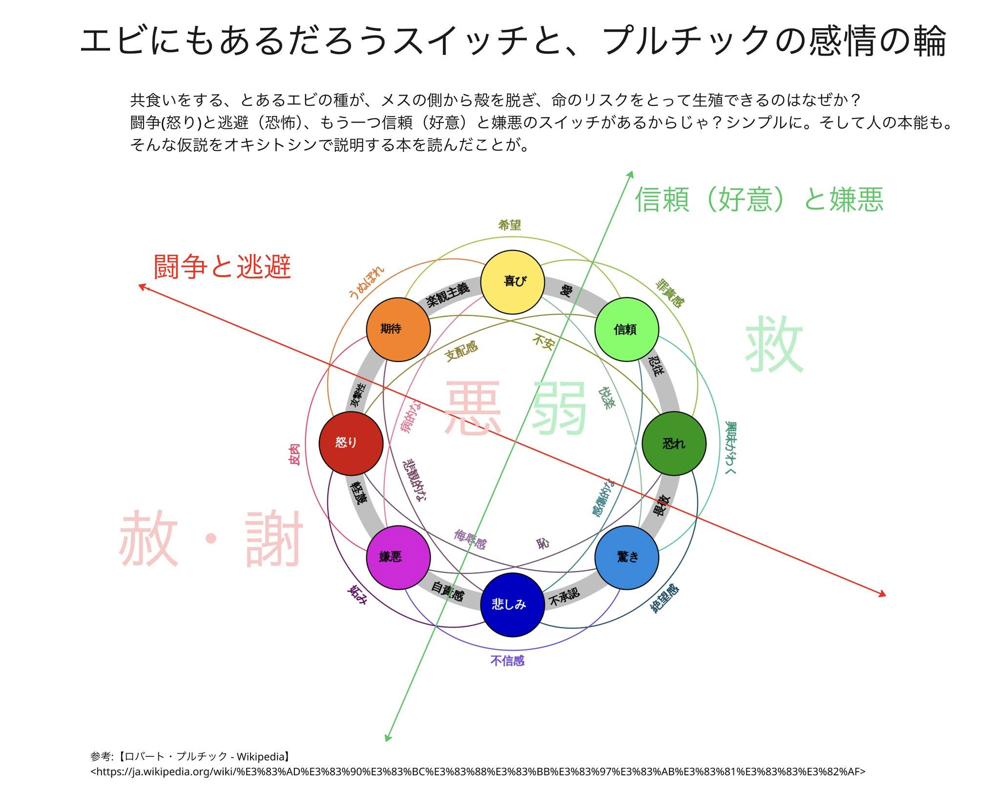

# pjdhiro の図「エビにもあるだろうスイッチと、プルチックの感情の輪」（書き起こし）

## 出どころ

pd#155 の ◎ 4-2（期待と信頼を別の扱いに切り出すか）の判定で、pjdhiro が出した方針と、そのあとに「参考にして」と貼った図。

**pjdhiro の判定（4-2）**：感情を表す言葉と誤解について別ページにまとめた方がいい。プルチックの感情の輪にある言葉から。

## 図の文字（逐語）

**題**：エビにもあるだろうスイッチと、プルチックの感情の輪

**本文**：共食いをする、とあるエビの種が、メスの側から殻を脱ぎ、命のリスクをとって生殖できるのはなぜか？
闘争(怒り)と逃避（恐怖)、もう一つ信頼（好意）と嫌悪のスイッチがあるからじゃ？シンプルに。そして人の本能も。
そんな仮説をオキシトシンで説明する本を読んだことが。

**参考**：【ロバート・プルチック - Wikipedia】（ja.wikipedia.org のロバート・プルチックの項）

## 図の構造（書き起こし・Claude による読み取り）

- 中央に、プルチックの感情の輪。基本の八つが円周に並ぶ：喜び・信頼・恐れ・驚き・悲しみ・嫌悪・怒り・期待。
- 隣り合う二つの間の言葉（輪の灰色の帯の上）：楽観主義（期待と喜び）・愛（喜びと信頼）・忍従（信頼と恐れ）・畏敬（恐れと驚き）・不承認（驚きと悲しみ）・自責感（悲しみと嫌悪）・軽蔑（嫌悪と怒り）・攻撃性（怒りと期待）。
- 外側と内側の弧に書かれた言葉：希望・うぬぼれ・罪責感・興味がわく・絶望感・不信感・妬み・皮肉・支配感・不安・悦楽・病的な・悲観的な・感傷的な・侮辱感・恥。
- **赤い矢印「闘争と逃避」**：左上から右下へ。怒りの側（左上）から恐れ・驚きの側（右下）へ抜ける軸。
- **緑の矢印「信頼（好意）と嫌悪」**：下（悲しみ・嫌悪の近く）から右上（喜びと信頼の間）へ抜ける軸。
- 二本の軸が交わる中心に、大きな文字で「悪」（赤の側）と「弱」（緑の側）。
- 輪の外の左下に、大きな薄い赤で「赦・謝」。右上に、大きな薄い緑で「救」。

## 読むときの注意（Claude の歯止め）

- 二本の軸（闘争と逃避／信頼と嫌悪）は、「意識とは」の生存と信頼の二つの方向と並ぶものに見えるが、同じものかは pjdhiro に聞くまで書かない。
- 「悪」「弱」「赦・謝」「救」は、新田信也『精神分析統合理論』の、悪さと弱さで分類する視点（pjdhiro が影響を受けた一点・台帳 11-05）と関わるように見える。図の中での意味は pjdhiro に聞く。
- 「オキシトシンで説明する本」の書名は図に無い。確かめるまで書名を当てない。
- プルチックの輪の言葉の訳語は、図の訳（Wikipedia 日本語版に基づくと思われる）をそのまま使う。原典（Plutchik 1980・2001 など）の英語との対応は、別ページを作るときに照合する。

## 同じときに置かれたもう一枚

`assets/img/creation-five-stages-spinor-v1-2.jpg`＝「創造の構造とプロセス：スピノル的５段階 Ver.1.2」（Step 1 場 Field〜Step 5 束 Bundle と、構造／プロセスの表：場＝無／漂う・波＝ゆれ、対立／分離・縁＝境界、関係／繋がり・渦＝個、立ち上がり／包摂、融合・束＝方向／集合。右下に NotebookLM の印）。pjdhiro が assets に置いたもの。用途は未定（2026-11-07）。
