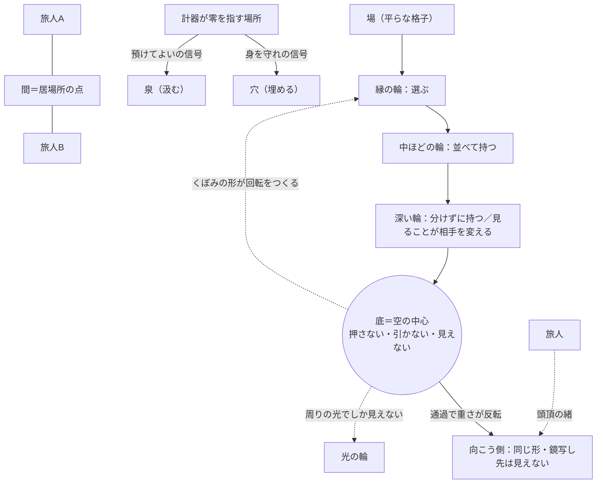

# 世界の規則書と地図（下書き）

> pd#141 の第 1 段階の作業台。**規則の採否・物語かゲームか・置き場（repo を分けるか）はすべて pjdhiro の判断待ち**で、ここでは決めない。
> 規則文は Claude の下書き。各条の出典に pjdhiro の言葉がある場合はそれを示す。

## 1. 目的

- CN-027 の線（ゼロの場所の構造 → ゼロと値が両立する論理 → ゼロの場所で湧く信号 → ゼロの場所から渦が起きるまで）を、**論として説明する代わりに、世界の物理として置く**。読者は説明を読むのでなく、その物理の中を歩いて挙動を体で知る（Litt の Micro-worlds＝「自分で触って挙動を直感できる環境」・CN-011 §2、reader-litt-conformance T2）。
- 手本は『神曲』。宇宙論を比喩でなく文字どおりの地理にした先例（地獄＝漏斗、重心の通過、反転、対称の半球、天球と点）。**手本であって引き写さない**（§5.4 に、引き写すと何が壊れるかを書いた）。
- pd#128 の教訓（Micro-worlds は題材を選ぶ。数理が正しくても直感に効かなければ落ちる）を前提にする。規則は「触ったら分かる」ものだけ残す。

## 2. 進め方（Issue 本文どおり・場当たりの大改稿をしない）

1. 規則書（本ファイル §3）を pjdhiro が一条ずつ見る（しっくり感＝採否は専権）。
2. 地図（§4）を規則書と突き合わせる。規則が地図のどこで「起きる」かが一対一に指せない条は、規則として弱い。
3. そのあとで、短い物語の試作か、ゲームの最小試作（どちらが先かは pjdhiro）。実装は Fable 設計 → Opus/Sonnet 委任。
4. 結晶したら独立の置き場へ（器を先に作らない）。

## 3. 規則書（下書き・十条＋追加候補二条）

書き方の約束:
- **規則文**は世界の中の住人が当たり前として知っている物理の形で書く（「〜とされる」「〜という考え」を使わない）。
- **世界の物理としての言い換え**は、地図の上で何が観測されるかを書く。ゲームなら「何をしたら何が起きるか」、物語なら「何が描写されるか」。
- **禁則チェック**の項目: ①看板語（三語）を使っていないか ②段階を人の等級にしていないか ③神曲の引き写しになっていないか ④定義番号で概念を参照していないか。

### 第一条 中心は何もしない

- **規則文**: 中心は押さない。引かない。動かない。それでも周りのすべては、中心がつくったくぼみの形に沿って回る。内側ほど速く、外側ほどゆっくり。
- **世界の物理として**: 旅人が中心に向けて何を投げても、中心は反応しない。投げたものは落ちて消えるのでなく、くぼみに沿って周回に入る。周回の速さは、中心からの距離だけで決まる。
- **出典**: gravity-love 2章「動いていないのに、駆動している」「何もない — 回しているのは、くぼみの形」（ケプラーの法則の形・星の中心で重力はゼロ）。3章（アリストテレス『形而上学』Λ7＝愛されるものとして動かす）。
- **禁則チェック**: ①なし ②なし ③『神曲』天国篇 28 歌の点（「その点に天とすべての自然がかかっている」28.41–42）と同型だが、ダンテの点は光り輝く。ここの中心は**光らない・空の輪**（gravity-love 1章の図と同じ）にして区別する ④なし。

### 第二条 自分の中心は自分に見えない

- **規則文**: どこに立っても、立っている点そのものは視野に映らない。中心に立つ者には、周りのすべてが自分を中心に回って見えるが、その中心だけが見えない。
- **世界の物理として**: 旅人の視界には常に一か所、何も描かれない点がある（視線をどう向けても、自分の足元の真下だけは描画されない）。自分が周りにどんなくぼみをつくっているかは、本人の画面には出ず、他の者の画面にだけ出る。
- **出典**: gravity-love 2章「自分からは見えない」（ウィトゲンシュタイン『論理哲学論考』5.633）、5章「周りの人には見えている自分の重さが、本人にだけ見えない」。
- **禁則チェック**: ①なし ②なし ③なし ④なし。

### 第三条 中心は、周りの光でしか見えない

- **規則文**: 中心を直接見る方法はない。中心のまわりを回る光の輪と、その内側の暗い影だけが、中心がそこに在ることを示す。
- **世界の物理として**: 旅人が他の者の中心を知りたいとき、手がかりは中心そのものでなく、そのまわりを回るもの（人・物・光）の軌道だけ。軌道を何周も観測すると、中心の重さが割り出せる（銀河中心の恒星の軌道を数十年追った観測と同じ型）。
- **出典**: gravity-love 2章 寄り道（EHT の M87・天の川銀河中心の画像、2020 年ノーベル物理学賞）。CN-026 補強「見えない所から来る信号で、そこに何かあると知る」。
- **禁則チェック**: ①なし ②なし ③なし ④なし。

### 第四条 測ると零、触れると満ちている

- **規則文**: この世界には直角に交わる二本の向きがある。動きの向きと、在ることの向き。在ることの向きにどれだけ値があっても、動きの向きの物差しで測ると、いつも零と出る。けれど体は、物差しを通さずに、その値の大きさをそのまま受け取る。
- **世界の物理として**: 旅人の道具（地図・計器・言葉）はすべて動きの向きの物差しで作られていて、中心の方角を測ると零を返す。一方で旅人の体には「重さ」「温かさ」「落ち着き」のような、計器に出ない感覚が届く。計器が零を指しているのに体が何かを受け取っている、という食い違いが、この世界ではふつうに起きる。
- **出典**: CN-026 体感のたとえ（pjdhiro「虚軸に値があって、しかも、認知上は 0 の直観」・定義でなくたとえ〔2026-11-05〕）と補強「認知は射影、体感は絶対値」。gravity-love 5章（cos 90°＝0）。対話録 §4。
- **禁則チェック**: ①なし（概念名を出さず、物差しと体の食い違いとして書いた） ②なし ③なし ④なし。

### 第五条 零の場所で湧く信号は二種類あり、どちらが湧くかで、くぼみの意味が変わる

- **規則文**: 計器が零を指す場所で、ときに信号が湧く。湧くのは二種類のどちらか。身を守れという信号が湧けば、くぼみは穴になり、旅人はそれを埋めようとする。預けてよいという信号が湧けば、くぼみは泉になり、旅人はそこから汲む。同じくぼみが、湧く信号で穴にも泉にもなる。
- **世界の物理として**: 地形は同じでも、信号の種類で地図の上の表示が変わる（穴として塗られるか、泉として塗られるか）。信号は旅人が選んで出せるものではない。ただ「零なのに何かが湧いた。これは何か」と問うことだけはできる。
- **出典**: CN-026 補強（pjdhiro「その信号がゼロの場所で沸いてしまうとしたら何？と思うことが、欠損への気づき」）。対話録 §4・§5（帯×信号の表）。信号の正本は awareness-space（生存の信号と信頼の信号）。
- **禁則チェック**: ①なし（概念名を使わず「穴／泉」で書いた） ②⚠️ 対話録 §5 の表は帯ごとに湧く信号を並べている。規則に帯を持ち込むと「泉が見える人は上の人」になるので、**規則文には帯を書かない**。帯との対応は §4 の地図の側で、場所として扱う ③なし ④なし。

### 第六条 降りても強くはならない。見える輪の数と、抱え方が変わる

- **規則文**: 井戸を一段降りると、それまで自分と重なっていて見えなかったものが一つ、見えるものの側に移る。力は増えない。増えるのは見えるものの数で、変わるのは抱え方（一つを選ぶ → 二つを並べて持つ → 分けずに持つ）。
- **世界の物理として**: 段を降りても、旅人の持てる重さ・速さ・武器は変わらない（強化の仕組みがない）。変わるのは画面に描かれる層の数と、二つのものを手にしたときの持ち方の選択肢。同じ旅人が、場所や出来事によって別の段に立つ。段は旅人に付く札でなく、地形に付く高さ。
- **出典**: CN-024（何を対象にできるか × どこまで包容しているか）。スクリーナー「段階のしくみ」。対話録 §5。
- **禁則チェック**: ①なし ②⚠️ もっとも危ない条。対策として三つを規則に埋め込んだ: 強くならない／段は地形の高さで人の札でない／同じ旅人が別の段に立つ（状態×段階の格子で、どの段にも深い状態は起こりうる・gravity-love 4章）。それでも「深い段ほど良い」と読まれる余地は残る → §7 保持論点 ③なし ④なし。

### 第七条 分けると見える。分けきった先で、分けられなくなり、層が変わる

- **規則文**: 自分の中のものを一つ指さすと、それは自分から離れて見えるものになり、指さした自分が残る。これを重ねていくと、最後に指さしている自分だけが残る。それを指さそうとすると、指さす側と指さされる側が重なって、もう分けられない。そこで物の振る舞いが変わる（細かく見るほど、見ることが相手を変え、芯は見つからず、関係の雲が現れる）。
- **世界の物理として**: 井戸の底に近づくほど、「見る」という操作が相手を変えるようになる（遠くでは見ても相手は変わらない）。底では、見る操作そのものが使えなくなる。境目はくっきりした線でなく、なだらか。
- **出典**: gravity-love 4章（pjdhiro の見方「観る私と観られる私が同じになる。分けられなくなる。そこからのプロセスは、古典から量子論に変わるような、違う感覚になる」・電子を細かく見ていくと起きること・デコヒーレンス）。
- **禁則チェック**: ①なし ②なし（「層が変わる」は地形の性質として書いた） ③なし ④なし。

### 第八条 つながっているものは、混ざらない

- **規則文**: 二つのものは、つながっても一つにならない。区別は残ったまま、切り離されていない。一つに溶けたように見えるときは、どちらかがもう一方に呑まれている。
- **世界の物理として**: 旅人どうしが緒（ひも）でつながると、互いの重さ・温度は伝わるが、姿・名前・持ち物は入れ替わらない。つながりを強めても、二人が一人の体になる操作はこの世界に存在しない。
- **出典**: スクリーナー README §8 参照体系 7.。gravity-love 4章「一つになる、ではなく二つでない。区別は残ったまま、切り離されていない」。対話録 §2（pjdhiro が退けた「融合の安定」でなく「接続の安定」）。
- **禁則チェック**: ①なし（語でなく否定の型で輪郭を引いた・対話録 §1 の表現原則） ②なし ③なし ④なし。

### 第九条 底を通り抜けると、同じ形の向こう側に出る。先は見えないのに、落ち着いている

- **規則文**: 井戸の底は行き止まりでない。底を通り抜けると、上と下が入れ替わり、同じ形をしたもう一つの空間に出る。ただし向こう側から先は、こちらからは見えない。見えないのに、旅人は不安にならない。緒でつながっているから。
- **世界の物理として**: 底の通過で重力の向きが反転し、旅人は逆さまに這い上がる形になる。出た先の地形は、来た側と鏡写しで同じ形。旅人の頭頂からは緒が一本、見えない先へ伸びていて、そこから重さと温かさが届く。旅人は緒の先を確かめることができない（確かめる操作がない）が、確かめる必要も起きない。
- **出典**: 対話録 §2（pjdhiro「ブラックホールの先に全く似たような形状のパイプで繋がった対称の空間があるイメージ」「見るしかできない私の頭頂の先にへその緒で接続された母の存在が安定をもたらすような落ち着きの感覚」「そもそも母がいることを胎児は認識していないでしょう」）・§3（「その先が見えない。なのに、不安定ではなく安定感」）。物理の対応＝アインシュタイン＝ローゼン橋（鏡像の外部空間・通れない）。『神曲』地獄篇 34 歌 76–111（重心の通過と反転・§5.1）。
- **禁則チェック**: ①なし ②⚠️ 対話録ではこの像を 6.5〜7 の帯の推測に当てている。規則文には帯を書かない（地図で「底の向こう」という場所として扱う） ③⚠️ 反転の場面は神曲そのもの。違いを三つ持たせて引き写しを避ける: ダンテは**通り抜けた先を自分の足で登って星を見る**（34.139）が、ここは**先は見えないまま**／ダンテの底には動けない悪がいるが、ここの底は**空**／ダンテを支えるのは導き手の肩だが、ここを支えるのは**緒** ④なし。
- **注**: 物理のローゼン橋は通れない（喉は光より速く閉じる）。この世界は「物理では通れない橋を、物語は通れる」を一か所だけ許す、という設計判断になる（§8 判断待ち）。

### 第十条 人は人と人の間に在り、自分は自らを分けたところに在る

- **規則文**: 旅人の居場所は、旅人の体の中にはない。旅人と旅人の間に在る。そして「自分」は、自らを分けた切り口に在る。だから一人きりの旅人は、居場所を持てない。
- **世界の物理として**: 旅人の位置座標は、一人のときには定まらない（地図に点が打たれない）。もう一人と緒でつながったとき、二人の間に初めて点が打たれる。旅人が自分の中の何かを分けて見るたびに、分けた切り口に小さな印が残り、それが旅人の「自分」の形になっていく。
- **出典**: gravity-love 6章（pjdhiro の問い「人間とは人と人との間に存在し、自分とは自らを分けたところに存在するとしたら」・和辻・唯識の四分・西田）。
- **禁則チェック**: ①なし ②なし ③なし ④なし。
- **注**: CN-027 の線は一人の内側の線で、この条（複数の中心の「間」と「束」）は線に乗っていない（CN-027 §2 保持論点）。規則書に入れると、線の外を世界が先に決めることになる → §8 判断待ち。

### 追加候補 A（Claude の追加・pjdhiro 未見）中心が動けば、場は凍る

- **規則文**: 中心が自分から動き出す（羽ばたく・押す・引く）と、その風で周りは凍り、中心自身もその氷に閉じ込められる。
- **出典**: gravity-love 5章「中心が何かを足すほど、場の形は崩れるのかもしれません」。『神曲』地獄篇 34.46–52（ルチフェロは六枚の翼を羽ばたかせ、その風でコキュートスが凍る。翼は動くが体は氷に固定されている）。
- **意図**: 第一条の**裏の規則**として、神曲の底を「悪」でなく「中心が動いたときの壊れ方」として読み替える案。経営者の問い（gravity-love 5章）にも接続する。
- **禁則チェック**: ③⚠️ 神曲の像に最も近い。採るなら翼・氷の具体は使わず、物理だけ取る。

### 追加候補 B（Claude の追加・pjdhiro 未見）惑星も自分の井戸を持つ

- **規則文**: 中心のまわりを回る旅人も、それぞれ自分の小さなくぼみを持ち、その周りを別のものが回っている。
- **出典**: gravity-love 5章「経営者は、愛の井戸を回る一つの点でありながら、自分の周りには自分の井戸を持つ」。
- **意図**: 第二条（自分のくぼみは自分に見えない）と第十条（間）をつなぐ入れ子。対話録 §2 で pjdhiro は 6.5〜7 の像としては「入れ子」より「橋」を選んだので、**この条は帯の像ではなく地形の入れ子**として置く。

## 4. 地図（下書き）

### 4.1 文章で

- 世界は一枚の平らな格子（場）で、その一点がくぼんで**井戸**になっている。井戸の縁から中心へ、同心の**輪**（段）が降りていく。
- **縁の輪**: 物・体・人・決まりが見える。旅人は一つを選んで動かす。
- **中ほどの輪**: 考え・感情・視点・仕組みが、見えるものの側に移っている。旅人は二つを並べて持つ。
- **深い輪**: 見ることそのもの・意味の作られ方が見える。旅人は分けずに持つ。ここで「見る」が相手を変え始める（第七条）。
- **底**: 空の輪。何もない中心。押しも引きもしないが、すべての輪の回転はこのくぼみの形から来る（第一条）。底に立つ者には、底そのものが見えない（第二条）。外からは、周りを回る光でしか見えない（第三条）。
- **通過**: 底を通り抜けると重さの向きが反転する（第九条）。
- **向こう側**: 来た側と鏡写しの同じ形の空間。先は見えない。旅人の頭頂から、見えない先へ**緒**が一本伸びている。
- **輪の性質**（第六条）: 輪は旅人の等級でなく地形の高さ。同じ旅人がその日の出来事で別の輪に立つ。どの輪でも、底からの重さは同じだけ届いている（測ると零・触れると満ちている・第四条）。
- **零の場所の泉／穴**（第五条）: 計器が零を指す場所は、地図上で「穴」とも「泉」とも塗られうる。どちらに塗られるかは地形でなく、そこで湧いた信号で決まる。
- **間**（第十条）: 旅人の点は、もう一人と緒でつながったときに、二人の間に打たれる。一人きりの旅人の点は地図に出ない。

### 4.2 断面図（ASCII）

```
            こちら側（来た空間）
   ────────────────────────────────────────  平らな格子＝場
     ＼  縁の輪  ：選ぶ（物・体・人・決まりが見える）   ／
       ＼  中ほどの輪：並べて持つ（考え・感情・仕組み） ／
         ＼  深い輪：分けずに持つ（見ることが相手を変える）／
           ＼＿＿＿＿＿＿＿＿ 底＝空の輪 ＿＿＿＿＿＿＿＿／
                         （ ○ ）  ← 何もない中心。測ると零
                           ┃      ← 通過：重さの向きが反転
           ／￣￣￣￣￣￣￣￣ 喉 ￣￣￣￣￣￣￣￣＼
         ／   向こう側も同じ形（鏡写し）              ＼
       ／        先は見えない                           ＼
     ／                                                   ＼
   ────────────────────────────────────────
            向こう側（見えない空間）

   旅人の頭頂 ──── 緒 ────→ （見えない先）  重さと温かさだけが届く
```

### 4.3 関係図（Mermaid）



### 4.4 神曲の宇宙図との対応

| 神曲（原典の位置） | この世界 | 同じところ | 違うところ（引き写さない点） |
|---|---|---|---|
| 地獄＝地球の内部へ降りる漏斗、九つの圏（地獄篇全体） | 井戸と同心の輪 | 降りるほど中心に近い同心構造 | 神曲の圏は**罪の重さ**の序列。この世界の輪は**見えるものの数**で、善悪・等級を持たない |
| 底に固定されたルチフェロ（34.28–29「胸の半ばから氷の外へ」、34.120「前と同じように突き刺さったまま」） | 底＝空の中心 | 底に「動けないもの」がいる | 神曲の底は**宇宙の最も愛から遠い所**。この世界の底は**すべてを回す空の中心**。価値の向きが逆 |
| 翼の風でコキュートスが凍る（34.46–52） | 追加候補 A（中心が動けば、場は凍る） | 動く中心が場を凍らせる | 神曲では罰の装置。この世界では第一条の裏の規則 |
| 重心の通過と反転（34.76–93、ウェルギリウスの説明 34.106–111「お前は、あらゆる方向から重さが引き寄せられる点を通り過ぎた」） | 第九条の通過 | 底を抜けると上下が入れ替わる | 神曲は通過後に地上へ登り「星を再び見る」（34.139）。この世界の向こう側は**見えないまま** |
| 反対側の半球、エルサレムの対蹠点（34.112–118、煉獄篇 4.67–71 シオンと煉獄山は地平線を共有し半球を異にする） | 向こう側＝鏡写しの空間 | 対称の空間 | 神曲の南半球は海と一つの山。この世界は**同じ形の井戸** |
| 煉獄山の成因：ルチフェロがこちら側へ落ち、陸は恐れて海の下に退き北半球へ、地の内部の土は逃げて山となり空洞を残した（34.121–126・ウェルギリウスは「おそらく」と言う） | （対応なし・保留） | 中心の落下が地形をつくる＝くぼみが地形を決める（第一条） | 神曲では堕落の結果。この世界に採るなら「くぼみが押しのけた分だけ向こう側が盛り上がる」という物理になる（§8 判断待ち） |
| 天国篇 28 歌：光る一点と九つの火の輪。点に近い輪ほど速く回る（28.25–36）。点に「天とすべての自然がかかっている」（28.41–42）。感覚の宇宙では外側ほど神的だが、ここでは内側ほど速く愛が強く、写し（essemplo）と原型（essemplare）が逆向き（28.46–57） | 第一条の中心と輪 | 動かない一点のまわりを、内側ほど速く回る（ケプラーの形と一致） | 神曲の点は**光そのもの**。この世界の中心は**光らない空**。また「物の宇宙と愛の宇宙が裏返しに対応する」という 28 歌の二重構造は、第九条の鏡写しと形が近い（次の段階で検討） |
| 原動天：「中心を静かにしてほかのすべてを周りに動かす宇宙の本性はここから始まる」、この天の場所は神の心のほかになく、そこで愛が燃える（27.106–111） | 第一条 | 中心は静止、周りが動く。動かす源は愛 | 神曲では最外の天が動かし、地球が静止の中心。この世界では中心が動かす |
| 至高天：「純粋な光の天、知性の光、愛に満ちた」（30.38–40） | （対応なし） | — | 向こう側の「見えない先」に当てるかは判断待ち。当てると「先は見えない」が崩れる |
| 最終行：「太陽とほかの星々を動かす愛」（天国篇 33.145）と冒頭行「すべてを動かすものの栄光」（天国篇 1.1） | gravity-love の題辞 | 動かす源の名を愛と呼ぶ | 規則書では**その名を出さない**（看板化禁止）。世界の中で名は与えられない |
| アリストテレス『形而上学』Λ7 1072b3「愛されるものとして動かす」 | 第一条 | 動かぬ動者 | — |

## 5. 原典照合の結果

### 5.1 ダンテ『神曲』（確認済み）

原文はイタリア語版ウィキソース（底本の校訂者は未確認。行数は地獄篇 34 歌＝139 行、天国篇 33 歌＝145 行、天国篇 1 歌＝142 行で標準と一致）から取得し、行番号を数えて確認した。日本語は Claude の訳出（下に既存訳の書誌）。

| 場面 | 行 | 原文（抜粋） | 意味（Claude 訳出） |
|---|---|---|---|
| ルチフェロは胸の半ばから氷の外に | 地獄篇 34.28–29 | Lo 'mperador del doloroso regno / da mezzo 'l petto uscia fuor de la ghiaccia | 苦しみの国の帝王は、胸の半ばから氷の外に出ていた |
| 翼の風で凍る | 34.46–52 | quelle svolazzava, / sì che tre venti si movean da ello: / quindi Cocito tutto s'aggelava | 翼を羽ばたかせ、三つの風が起こり、それでコキュートス全体が凍っていた |
| 毛を伝って降り、腰の所で頭を脚の側へ向け替える | 34.76–81 | Quando noi fummo là dove la coscia / si volge … / volse la testa ov'elli avea le zanche | 腿が曲がる所、腰の太い所に来たとき、導き手は苦労して、脚のあった方へ頭を向けた |
| 振り返るとルチフェロの脚が上に | 34.88–93 | e vidili le gambe in sù tenere … qual è quel punto ch'io avea passato | 脚を上に向けているのが見えた。自分が通り過ぎた点が何か分からない者には分かるまい |
| 重心の説明 | 34.106–111 | quand'io mi volsi, tu passasti 'l punto / al qual si traggon d'ogne parte i pesi | 私が向きを変えたとき、お前は、あらゆる方向から重さが引き寄せられる点を通り過ぎた |
| 反対の半球 | 34.112–118 | E se' or sotto l'emisperio giunto / ch'è contraposto … / Qui è da man, quando di là è sera | お前は今、反対の半球の下にいる。向こうが夕べのとき、ここは朝だ |
| 煉獄山の成因 | 34.121–126 | Da questa parte cadde giù dal cielo; / e la terra, che pria di qua si sporse, / per paura di lui fé del mar velo … e forse / per fuggir lui lasciò qui loco vòto / quella ch'appar di qua, e sù ricorse | こちら側に天から落ちた。もとこちらに出ていた陸は彼を恐れて海を覆いとし、我らの半球へ移った。そしておそらく、こちらに見える土は彼から逃れて空洞を残し、上へ駆け上がった |
| 星を再び見る | 34.139 | E quindi uscimmo a riveder le stelle. | そしてそこから出て、再び星を見た |
| 煉獄山とエルサレムは対蹠 | 煉獄篇 4.67–71 | imagina Sïòn / con questo monte in su la terra stare / sì, ch'amendue hanno un solo orizzòn / e diversi emisperi | シオンとこの山は一つの地平線を持ち、半球を異にする |
| 原動天 | 天国篇 27.106–111 | La natura del mondo, che quïeta / il mezzo e tutto l'altro intorno move … la mente divina, in che s'accende / l'amor che 'l volge | 中心を静かにし、ほかのすべてを周りに動かす宇宙の本性は、ここから始まる…神の心のうちで、この天を回す愛が燃える |
| 点と九つの輪 | 天国篇 28.16–18, 25–36 | un punto vidi che raggiava lume … e chiascheduno / più tardo si movea, secondo ch'era / in numero distante più da l'uno | 光を放つ一点を見た…それぞれの輪は、一から数えて遠いほど遅く動いた |
| 点にかかる | 天国篇 28.41–42 | Da quel punto / depende il cielo e tutta la natura | その点に、天とすべての自然がかかっている |
| 写しと原型が逆向き | 天国篇 28.46–57 | ma nel mondo sensibile si puote / veder le volte tanto più divine, / quant'elle son dal centro più remote … l'essemplo / e l'essemplare non vanno d'un modo | 感覚の世界では、中心から遠い天ほど神的に見える…写しと原型が同じ向きに進まない |
| 至高天 | 天国篇 30.38–40 | al ciel ch'è pura luce: / luce intellettüal, piena d'amore | 純粋な光の天へ。知性の光、愛に満ちた |
| 冒頭行 | 天国篇 1.1 | La gloria di colui che tutto move | すべてを動かすものの栄光 |
| 最終行 | 天国篇 33.145 | l'amor che move il sole e l'altre stelle | 太陽とほかの星々を動かす愛 |

日本語訳の書誌:
- 原基晶 訳『神曲 地獄篇』講談社学術文庫 2242、2014 年 6 月、ISBN 9784062922425（底本 Petrocchi 校訂本）— 確認済み（講談社・丸善ジュンク堂の書誌）。煉獄篇・天国篇も同文庫 2014 年。
- 平川祐弘 訳『神曲』河出書房新社（単行本 1992 年）、河出文庫版は煉獄篇 2009 年 1 月（NDL）を確認。**地獄篇の河出文庫版の刊行年・ISBN は未照合**。
- 山川丙三郎 訳（岩波文庫・青空文庫『神曲 03 天堂』）— gravity-love の出典に既出。行番号との対応は未照合。
- 引用を公開物に出すときは、既存訳を使うなら訳者・頁を照合してから（**頁は全て未照合**）。

アリストテレス『形而上学』Λ7 1072b3「κινεῖ δὴ ὡς ἐρώμενον, κινούμενα δὲ τἆλλα κινεῖ」（愛されるものとして動かし、動かされたものがほかを動かす）— Perseus Digital Library の Ross 本文で確認。日本語訳（出隆 訳・岩波文庫など）の頁は未照合。

### 5.2 小島秀夫『Death Stranding』（2019）（一部確認）

| 項目 | 結果 | 根拠 |
|---|---|---|
| 安部公房の棒と縄 | **確認済み（開発者の一次発言）**。小島は Game Informer のインタビュー（Andrew Reiner、2016-06-15）で、安部公房の考えとして、人類最初の道具は悪いものを遠ざける棒で、次に縄が来た、縄には大事なものを自分に結び寄せる可能性がある、と語り、「つながりがゲーム全体のテーマ」と述べた | gameinformer.com 2016-06-15 |
| ゲーム冒頭のエピグラフの文面 | **未照合**。二次記事では冒頭に安部公房「なわ」からの引用が出るとされるが、画面上の正確な文面（英語・日本語）は一次で確認できていない | 二次記事のみ |
| 安部公房「なわ」の初出 | **未照合**。新潮文庫『無関係な死・時の崖』所収の一篇であることは書店紹介で確認。初出誌・年は全集の解題で要確認 | 書店紹介 |
| BB（ブリッジ・ベイビー）とポッド | **一部確認**（報道・ファンwiki 水準）。BB は死んだ母体から取り出され、母胎の条件を模したポッドに入れられ、生者の世界と死者の世界をつなぐ媒介として運び手（サム）が BT を感知するのに使う。開発者の一次の説明文は未照合 | Newsweek・Gematsu（Gamescom 2019 トレーラー報道）・ファンwiki |
| 臍の緒 | **一部確認**（報道水準）。登場人物ママの子は「向こう側」で生まれ、臍の緒だけでつながっている（Gamescom 2019 トレーラー報道）。生と死の間の「浜（ビーチ）」が舞台装置 | Gematsu 2019 |
| 「ストランド」の語義の公式説明 | **未照合**。小島の「ストランド・ゲーム」という呼び方と語義（糸・座礁）の公式説明は一次で確認できていない | — |

**像の近さ**: 「臍の緒で、向こう側の見えない何かにつながる」は第九条の緒にきわめて近い。違いは、Death Stranding の向こう側は**死者の世界で、脅威（BT）が来る側**でもあり、緒は**危険を感知する道具**として使われる点。この世界の緒は危険を知らせるのでなく**落ち着きを届ける**。近すぎるので、第九条の具体（胎児・ポッド・ベビー）は採らず、「頭頂の緒」だけにとどめるのがよい（§8 判断待ち）。

### 5.3 『Journey』（thatgamecompany、2012）（一部確認）

- **確認済み（開発者の一次発言の報道）**: ジェノバ・チェンは GDC 2013 の講演で、オンラインの見知らぬ二人の間に新しい感情を起こしたかった、武器やアイテムは人より力を優先させるので、プレイヤーと世界の力関係を逆にし、銃も戦闘もない静かな世界にした、相手を置いて去ることもできるから協力が本物になる、プレイ中は名前もボイスチャットもなく終わりに名前が出る、と述べた（Adventure Gamers 2013-04 の講演レポート）。名札がないのは二人の人間の水準で関わらせるため、という発言は Shacknews 2010 の E3 プレビューにある（見出しの確認のみ・本文は未精読）。
- **未照合**: 構造としての英雄の旅（キャンベル）の採用を語ったチェンの一次発言。GDC Vault の講演映像そのもの。

### 5.4 『Outer Wilds』（Mobius Digital、2019）（一部確認）

- **確認済み（開発者の一次発言）**: クリエイティブディレクターのアレックス・ビーチャムは Mobius Digital 公式ニュース「The Intentionality of Wandering」（2016-08-18）で、選択が好奇心から動機づけられることがゲームの要点、プレイヤーが意識的に選べるだけの情報を与える、完全に自由で何をすべきかは言わない、と語った。
- **一部確認（二次）**: 「進行を制限するのはプレイヤーの知識だけ」「22 分のループで持ち帰れるのは知識だけ」は SF Encyclopedia などの二次の記述。ビーチャム自身の一次の言い回しとしては未照合。
- **ゲーム内の仕組み（ファンwiki 水準）**: 脆い空洞（Brittle Hollow）の中心のブラックホールに落ちると、ホワイトホールから出る（対になった穴）。量子の月は観測されていないあいだ位置を変える。宇宙より古い信号源「宇宙の眼」。開発者の一次の説明は未照合。

## 6. 先例の照合（三作品が規則のどれに当たるか）

| 規則 | 神曲 | Death Stranding | Journey | Outer Wilds |
|---|---|---|---|---|
| 一 中心は何もしない | ◎ 天国篇 27・28 歌の点と原動天（ただし点は光る） | — | △ 遠くの光る山が全員を引き寄せる（構図として。設計発言は未照合） | △ 太陽系の中心（設計意図としての対応は未照合） |
| 二 自分の中心は自分に見えない | — | — | — | — |
| 三 周りの光でしか見えない | △ 28 歌の点は直視できず目を閉じる（28.16–18） | — | — | △ 宇宙の眼は信号としてしか知られない（ゲーム内設定） |
| 四 測ると零、触れると満ちている | — | △ BB を通してだけ見えない BT を感知する（感知の構造が近い・向きは逆） | ○ 言葉も名前もないのに相手の存在が届く | — |
| 五 零の場所の二種類の信号 | — | △ 向こう側が脅威でもある（生存の側が強い） | — | — |
| 六 降りても強くならない | — | — | ○ 力関係の逆転・武器なし（チェン GDC 2013） | ◎ 強化でなく知ることで世界が開く（ビーチャム 2016＋二次） |
| 七 分けきった先で層が変わる | — | — | — | ○ 量子の月（観測が相手を変える・ゲーム内設定） |
| 八 つながるものは混ざらない | — | ○ 縄は結び寄せるが一つにしない（棒と縄・小島 2016） | ◎ 二人は名前を知らないまま協力し、去ることもできる（チェン GDC 2013） | — |
| 九 底を抜けると対称の空間・先は見えないのに安定 | ◎ 34 歌の通過と反転（ただし先は見える＝星） | ◎ 臍の緒で向こう側とつながる（ただし向こう側は脅威でもある） | — | ○ ブラックホール→ホワイトホール（ゲーム内設定） |
| 十 人は間に在る | — | ◎ つながりがテーマ（小島 2016） | ◎ 見知らぬ二人の間の感情（チェン GDC 2013） | — |

（◎＝規則の核と重なる／○＝部分的に重なる／△＝構図だけ近い／—＝対応なし）

- 第二条（自分の中心は自分に見えない）は三作品のどれにも当たらない。この世界に固有の条になりうる。
- 第五条（同じくぼみが信号で穴にも泉にもなる）も先例が薄い。ここもこの世界の固有性。
- 神曲は「地形」、Journey は「他者」、Outer Wilds は「段＝知ること」、Death Stranding は「緒」を先にやっている。四つを足すと引き写しの寄せ集めになるので、**固有の二条（第二・第五）を世界の軸に据える**案がある（§8 判断待ち）。

## 7. 保持論点（急いで解かない）

1. **段が等級に読まれる危険**（第六条・地図の輪）。地形の高さと書いても、降りる方向に価値が付いて読まれる余地は残る。神曲の地獄は降りるほど罪が重く、天国は昇るほど至福に近い＝**方向そのものが価値を運ぶ**伝統の上にいる。
2. **神曲と価値の向きが逆**。神曲の宇宙の中心（地球の底）は愛から最も遠い所で、愛の中心は宇宙の外側（至高天）にある。この世界は「底の空の中心が回す」。28 歌の「写しと原型が逆向き」は、この逆転を神曲自身が持っている証拠にもなるが、読者が神曲を知っていると混乱を生む。
3. **ローゼン橋は通れない**。第九条は「物語は通れる」を一か所だけ許す設計。通れることにすると、pjdhiro の「先が見えない」と衝突しないか（通れるなら見えるのでは）。「通れるが、通った先は見えない（向こう側に出た瞬間、来た側が見えなくなる）」という折衷もありうる。
4. **第十条は CN-027 の線の外**。一人の内側の線（第一〜第九条）と、間（第十条）を同じ規則書に置くと、線が二本目を要るかの問いを世界の側で先に決めてしまう。
5. **へそ＝分けたところの痕跡**（対話録 §2・Claude の追加・pjdhiro 未回答＝入れないのが既定）。第十条の「切り口の印」に近づけて書いた箇所があるが、へそは書いていない。
6. **「全てかもしれない」**（信頼の信号そのものが緒の安定感か・CN-026 未回答）。第五条の「預けてよいの信号」と第九条の「緒」を同じものにするか別にするかは、この未回答に依存する。
7. **Micro-worlds は題材を選ぶ**（pd#128）。第四条（直交と射影）は数理として正しくても、触って直感に効くかは試作するまで分からない。720° と同じ落ち方をする候補。
8. 原典の未照合（§5 の各「未照合」）。公開物に引用する前に一次へ戻る。

## 8. pjdhiro 判断待ち（一条ずつ）

1. 第一条「中心は何もしない」を採るか。
2. 第二条「自分の中心は自分に見えない」を採るか。
3. 第三条「中心は周りの光でしか見えない」を採るか。
4. 第四条「測ると零、触れると満ちている」を採るか（触って効くかの試作が要る）。
5. 第五条「零の場所の二種類の信号で、くぼみが穴にも泉にもなる」を採るか。「穴／泉」の語でよいか。
6. 第六条「降りても強くならない」を採るか。輪を「降りる」向きにするか、別の形（入れ子・水平の移動）にするか。
7. 第七条「分けきった先で層が変わる」を採るか。
8. 第八条「つながっているものは混ざらない」を採るか。
9. 第九条「底を抜けると対称の空間・先は見えないのに安定」を採るか。物語に「通れない橋を通る」を一か所許すか（保持論点 3 の折衷案を含む）。緒を頭頂に置くか。
10. 第十条「人は間に在る」を規則書に入れるか、線の外として別紙にするか。
11. 追加候補 A「中心が動けば、場は凍る」（神曲 34.46–52 の読み替え）を採るか。
12. 追加候補 B「惑星も自分の井戸を持つ」を採るか。
13. 地図の形（同心の輪で降りる井戸＋通過＋鏡写しの向こう側）でよいか。煉獄山の成因に当たる「くぼみが押しのけた分だけ向こう側が盛り上がる」を地形に入れるか。
14. Death Stranding と近すぎる具体（胎児・ポッド）を避け、「頭頂の緒」だけにとどめるか。
15. 世界の軸に固有の二条（第二・第五）を据えるか。
16. 物語（小説）とゲーム（最小試作）のどちらを先にするか。
17. 置き場：この Issue の作業台のまま続けるか、結晶したら独立の repo へ移すか（その時期）。
